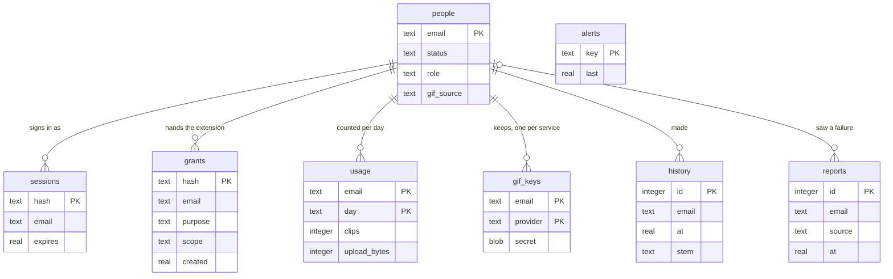

# Data model

Last updated **2026-10-31T13:12:52+05:30** (checked against Scheduled Statuses, Release 1, and extension 2.1.1; before that 2026-10-25T15:18:44+05:30)

What this project keeps, where, for how long, and how it changes shape. Read from the
code: `wastatus/accounts.py`, `hosted.py`, `portal.py`, `watch.py`, `pipeline.py`,
`retention.py`, `runlog.py`, `stickers.py` and `src/sw.js`. The routes that read and
write all of it are in [API.md](API.md); why each piece exists is in
[DECISIONS.md](DECISIONS.md); what is protected and how is in
[SECURITY.md](SECURITY.md); how it fits together is in
[ARCHITECTURE.md](ARCHITECTURE.md).

The local tool keeps files and nothing else. The hosted site adds one SQLite file and a
data volume. The extension keeps its state in the browser.

## The people database

`/data/people.db` on the hosted site (`Accounts(root / "people.db")`). One process
reads and writes it: a connection per thread, `journal_mode=wal`, one write lock so
two requests never race on a counter, file mode 600. Every secret in it is a SHA-256
hash or encrypted, never itself. D-089, D-095.

**Relationships are by email, and only by convention.** No table declares a foreign
key; `forget` deletes a person's rows table by table. Outside the database a person is
named by `person_id(email)`, the first 24 hex characters of
`sha256("wastatus:" + email)`: their folder `users/<id>/`, and the owner `p:<id>` of
the uploads their grants make in the renderer. Times are Unix seconds (`real`); a
`day` is `YYYY-MM-DD` in UTC.

**Table DM-1: `people`**, one row per person who asked, or was added

| Column | Type | Holds |
|---|---|---|
| `email` | text, primary key | lower cased, at most 254 characters |
| `name` | text | at most 120 |
| `status` | text | `pending`, `approved`, `declined`, `suspended` |
| `role` | text | `user` or `admin`. `admin` only for addresses in `WASTATUS_ADMIN_EMAILS`, set at every start; taken off the list, back to `user` |
| `answers` | text, JSON | `{name, use, heard}` from the request, at most 120, 600 and 200 characters |
| `google_sub` | text, nullable | Google's account id: set by a request through Google, or bound at the first Google sign-in; a later sign-in from another Google account is refused (D-101) |
| `created`, `decided`, `last_seen` | real | `last_seen` is written at sign in and at most every five minutes of use |
| `gif_source` | text | `''`, `giphy`, `klipy` or `both` |
| `picture` | text | Google's photo address, at most 500 characters; anything but `https` on `*.googleusercontent.com` is stored as empty |
| `lim_clips` | integer, nullable | the admin's clips a day for this person. Null means the default (`WASTATUS_CLIPS_PER_DAY`). Added 2026-10-31 |
| `lim_upload` | integer, nullable | upload bytes a day. Null means `WASTATUS_UPLOAD_MB_PER_DAY` |
| `lim_pending` | integer, nullable | scheduled posts allowed. Null means 30, or 90 for an admin |
| `lim_budget` | integer, nullable | bytes of held clips the extension may keep for this person. Null means 400,000,000, or 1,000,000,000 for an admin |
| `lim_scheduling` | integer, nullable | the scheduling pilot switch, 1 or 0. Null means off, or on for an admin |

**Table DM-2: the other tables**

| Table | Key | Columns | Written by | Read by | Kept |
|---|---|---|---|---|---|
| `sessions` | `hash` (SHA-256 of a 32 byte token) | `email`, `created`, `expires` (created plus 30 days, not sliding), `last_seen`, `agent` ("Chrome on Linux", at most 60) | sign in, sign out, ending sessions, a decline or suspension | every signed in request, the account page | until expiry; expired rows go whenever a session starts |
| `grants` | `hash` | `email`, `purpose` (`upload` or `clip`), `scope` (the stem, for a clip), `expires`, `created` | `POST /api/grant`; `check_grant` slides `expires` to 15 minutes on use, never past two hours after `created` (D-101) | the renderer's upload routes, `GET /api/v1/clip` | rows an hour past expiry go at each new grant; all of a person's go when their last session ends |
| `usage` | (`email`, `day`) | `clips`, `failures`, `upload_bytes`, `render_seconds` | `reserve_upload` (the check and the count in one transaction), `refund_upload`, `count_clip` | the daily limits, `/api/account`, `/api/admin`, the digest | not pruned |
| `gif_keys` | (`email`, `provider`) | `secret` (Fernet, keyed by `sha256("gif:" + WASTATUS_SECRET_KEY)`), `created` | `POST /api/gifkey`, `/api/gifkey/delete` | each request and render, bound to the person | until removed. A changed `WASTATUS_SECRET_KEY` leaves old keys unreadable, and they are ignored |
| `history` | `id`, autoincrement; index `history_by_person (email, at)` | `at`, `video_id`, `title`, `channel`, `mode`, `start`, `end`, `stem`, `ok`, `seconds`, `error` | the end of every hosted page render, only while the person exists | `/api/account/history` | 90 days (`HISTORY_DAYS`): pruned at each insert, filtered at each read |
| `reports` | `id`, autoincrement | `at`, `email`, `source` (`render`, `capture`, `load`, `page`, `words`, `feedback`), `phase`, `code`, `detail` (at most 400), `versions` | `POST /api/report`, `/api/feedback`, a failed render | `/api/admin`, the digest, the failure alert | 30 days, pruned at each insert |
| `alerts` | `key` | `last`, `count` | `should_alert`: one message per key per period; also the `daily:<day>` marker that runs the daily jobs once | the same | not pruned |

**Deleting a person** (`Portal.forget`, from `/api/account/delete`, `/api/admin/forget`
or `wastatus hosted user forget`): their `sessions`, `grants`, `usage`, `gif_keys` and
`history` rows and their `people` row go, their `reports` keep no email, and
`users/<id>/` is removed after any render of theirs has stopped. An admin is refused
before anything is touched.

## The hosted data volume

`WASTATUS_HOSTED_DATA=/data` in the image, a named volume, owned by the unprivileged
`wastatus` user, written under `umask 027`. `/data/backups` is a second volume mounted
inside it. See [DEPLOYMENT.md](DEPLOYMENT.md).

**Table DM-3: `/data`**

| Path | Holds | Written by | Kept |
|---|---|---|---|
| `people.db`, `-wal`, `-shm` | the database above | `accounts` | always |
| `tokens.json` | popup tokens: `{sha256: {name, created}}`, mode 600, replaced atomically | `wastatus hosted token add/revoke` | until revoked |
| `uploads/<id>.bin` | an upload's bytes so far | `PUT /api/v1/uploads/<id>` | 30 minutes idle, then the janitor deletes it and gives back the unsent bytes |
| `uploads/<id>.json` | `{id, owner, kind, size, created}`, so a restart picks the upload up again | `POST /api/v1/uploads` | with its `.bin`, or until a job claims it |
| `jobs/<id>/job.json` | a popup job: its JSON answer plus `owner`, `user`, `request`, `clip`, `created_at`, `finished_at` | the renderer | an hour after it finishes; a job active at a restart is recorded as failed |
| `jobs/<id>/audio.media`, `video.media`, `artwork.jpg` | the claimed uploads | `POST /api/v1/jobs` | deleted when the render ends |
| `jobs/<id>/out/` | the clip and its sidecars, Table DM-5 | `pipeline.produce` | with the job |
| `users/<id>/out/` | a person's clips and sidecars | their renders | the newest 10 (`KEEP_CLIPS`); the whole folder after 90 days without a visit (`watch.tidy`); `.mp4.part` claims are removed at start |
| `users/<id>/stickers/mine/` | stickers they uploaded | `POST /api/sticker` | at most 60, until deleted |
| `users/<id>/stickers/gifs/` | GIFs they picked | `POST /api/gif/pick` | the newest 20 (`GIF_KEEP`) |
| `users/<id>/stickers/cache/<width>/` | scaled copies | `GET /api/sticker?w=` | derived; deleting costs nothing |
| `users/<id>/work/<16 hex>/` | the uploads a page render claimed | `Workspace.render_captured` | deleted when the render ends; every `work/` is removed at start |
| `stickers/` | the shared OpenMoji library, `openmoji/` and `openmoji.json` (`WASTATUS_STICKER_DIR`) | `scripts/setup_stickers.sh`, copied in once | always |
| `backups/people-YYYY-MM-DD.db` | a copy of the database, mode 600 | `watch.backup`, daily after 03:00 UTC | the newest 7 |
| `logs/wastatus.log`, `runs.jsonl` | the text log (2 MB, three kept) and the run records, Table DM-6 | `runlog` | `runs.jsonl` is appended and never rotated |
| `tmp/` | `TMPDIR`: render scratch folders `wastatus-*` | `pipeline` | removed after each render, and swept at start |
| `extension/snipshare-extension.zip` | the download offered on `/install` | the deploy | until replaced |

## The local `out/` folder

`wastatus serve` and the command line write here (`-o`, default `out/`). One clip is a
group: the mp4 and every sidecar `retention.SIDECAR_SUFFIXES` names, pruned and
deleted together. The same layout is used in `users/<id>/out/` and `jobs/<id>/out/`.

A stem is `YYYYMMDD_<song-slug>_<start>-<end>`, plus `_video` in video mode and `-2` to
`-99` when the name is taken (`naming.build_stem`, `reserve_stem`).

**Table DM-4: a clip's files**

| File | Holds | Written | Read by |
|---|---|---|---|
| `<stem>.mp4.part` | the claim on the name, made with `O_EXCL`, which the render then lands in | at the start of a render; removed on every exit | nothing; the page's `*.mp4` glob cannot see it |
| `<stem>.mp4` | the clip, Table AR-1 in ARCHITECTURE.md | renamed into place when finished | the page, posting, the downloads |
| `<stem>.caption.txt` | the Status caption: the video's link, editable | the render; `POST /api/caption` | posting, the page |
| `<stem>.status2.txt` | the follow up text | only when the render asked for `follow_up` | the follow up post |
| `<stem>.json` | the job that made the clip, Table DM-5 | the render | the page, to refill its form and to draw previews |
| `<stem>.png` | a still from the middle of the clip | the render | the page |
| `<stem>.base.png` | video mode: a frame with nothing of ours on it | the render | `/api/preview` |
| `<stem>.art.jpg` | card mode: the artwork | the render | `/api/preview` |

**Table DM-5: `<stem>.json`**

| Field | Holds |
|---|---|
| `url`, `start`, `end` | the link and the window, in seconds |
| `video`, `wave`, `fill` | the mode, the waveform switch, `blur` or `black` |
| `title`, `channel`, `footer`, `eyebrow`, `topline` | the words drawn |
| `picture_top`, `picture` | where the picture landed: a row, and `{width, height, left, top}`. Not settings; the preview needs them |
| `framing` | the placement asked for, or null when fitted |
| `stickers` | every decal placed |

Older clips may lack the file or some fields; every reader falls back.

**Retention.** `retention.prune` keeps the newest `--keep-last` clips (20 by
default, 0 keeps all), by the mp4's modification time, after every render. A clip being
posted is held (`retention.hold`) and skipped however old it is.

## The run log

`logs/runs.jsonl` beside the code, or `WASTATUS_LOG_DIR` (`/data/logs` hosted). One
JSON object per run, appended when it finishes (`runlog.Run.finish`). It is the record
of when a clip was made and which extraction route worked.

**Table DM-6: a run record**

| Fields | When |
|---|---|
| `started_at` (ISO 8601 UTC), `status` (`ok`, `failed`, `error`, `cancelled`), `stages` (`{name: seconds}`), `elapsed`, `error` | every run |
| `url`, `start`, `end`, `duration`, `mode`, `source` (`web`, `hosted-page`), `follow_up`, `post` | as the front end started it |
| `video_id`, `raw_title`, `title`, `channel`, `raw_channel`, `raw_artist`, `stickers`, `fill`, `framing`, `stem` | from the pipeline |
| `client`, `format`, `source_bytes`, `failed_attempts` | a local download through yt-dlp |
| `output`, `output_bytes`, `frame`, `frame_at`, `pruned_groups`, `pruned_bytes` | a finished clip |
| `kind` (`post` or `load`), `port`, `browser`, `seconds`, `sent` | a post from the local page |
| `post_port`, `loaded`, `posted`, `post_seconds`, `posted_follow_up`, `post_error`, `post_follow_up_error` | a post from the command line |
| `hosted`, `user`, `job`, `video` | a popup job on the renderer |

`output` is a path on the machine that made the clip. The file is local and never sent
anywhere.

## The extension's storage

All in the person's own Chrome. `src/sw.js` writes every step down so a worker Chrome
has stopped resumes from what is stored. D-082.

**Table DM-7: `chrome.storage.local`**

| Key | Holds |
|---|---|
| `settings` | `{server, token, quality}`: the popup's renderer address, its access token, and `hd720` by default |
| `job` | the popup's one clip in flight, Table DM-8. Removed by Stop |
| `pace` | `{captures: [ms], loads: [ms], scheduled: [ms]}`: the last hour's site captures, loads and scheduled runs, for the 20, 10 and 40 an hour limits |
| `sched` | the scheduled queue, Table DM-11: `{items: [Schedule], paused: null or {at: ms}, seq}` |
| `schedHistory` | finished and cancelled schedules, kept 30 days |
| `schedLog` | the run log, the last 200 runs: codes and timings only (OBSERVABILITY.md) |
| `placeStats` | the per machine record of how each placement rung did, below |
| `schedLimits` | `{pending, budgetBytes}` as the page last told the extension |
| `settings` | gains the scheduling fields: `bringForward` false, `idleForward` false, `quietOn` true, `quietStart` `"23:00"`, `quietEnd` `"07:00"`, `gapMinutes` 180, `perPostNotices` false |

`queue-peek` (extension 2.1.1) stores nothing new: its `lastDue`, `gapMinutes` and `quiet`
are read from `sched` and the scheduling fields of `settings` at the moment of asking
(D-107).

**Table DM-8: the `job` record**

| Field | Holds |
|---|---|
| `key` | `j<time><random>`, the prefix of its IndexedDB keys |
| `created`, `updated` | milliseconds |
| `phase` | `capturing`, `uploading`, `queued`, `rendering`, `downloading`, `ready`, `failed` |
| `progress`, `detail`, `error`, `retryFrom` | what the popup shows, and the phase Try again resumes from |
| `tabId`, `videoId`, `title`, `author`, `duration`, `start`, `end`, `mode`, `fill`, `titleOverride`, `channelOverride` | what was asked for |
| `files` | `{kind: bytes}` captured |
| `uploads` | `{kind: {id, received, chunk}}` on the renderer |
| `chunk` | the chunk size reached, so a restarted worker does not start again at 64 KB |
| `posting` | set while `POST /jobs` is in flight, so a lost answer is looked up with `GET /jobs` instead of sending again |
| `serverJob` | the renderer's job id |
| `clip` | `{size, caption, title, name}` once the render is done |

**Table DM-11: a schedule in `sched.items`**, added 2026-10-31T01:52:02+05:30

| Field | Holds |
|---|---|
| `id`, `rev` | `s_` and ten random characters; a revision that rises on every change, so a stale edit is refused (`conflict`) |
| `created`, `due`, `zone` | milliseconds; the time zone is for display only |
| `stem`, `name`, `caption`, `mode` | the clip on SnipShare, the file name, the caption (at most 1,024), `card` or `video` |
| `size`, `sha256`, `custody`, `fetched` | bytes, the hash kept once the clip is whole, `fetching` or `local`, bytes fetched so far |
| `action` | always `prepare` in this release |
| `catchUp` | how late a run may still go ahead, 30 minutes |
| `state` | `holding`, `scheduled`, `prewarmed`, `waiting`, `running`, `asked`, `prepared`, `failed`, `missed`, `cancelled`, `done`. Pending (counting against the limits) is every state but `done` and `cancelled` |
| `rung`, `attempts`, `error`, `outcome` | the placement rung used (`S0` to `S5`), tries so far, `{message, code}`, and the last result code |
| `origin`, `looked`, `repeat` | `editor`, true and null in this release |
| `waitUntil`, `deleteAfter` | stored deadlines: the next look while waiting, and when a cancelled row goes (10 seconds, so Undo works) |
| `ranAt`, `endedAt` | milliseconds |

`placeStats` holds, per rung (`S0` to `S5`), `{wins, fails, streak, moved, placed,
lastWin, lastFail, ms}`, plus when the quiet test last ran. A rung that failed three
times running is left alone for a week. While the queue is paused items keep their
state and `sched.paused` is the switch.

**IndexedDB** database `wastatus`, version 1, one object store `blobs`, keyed
`<job.key>:<part>`:

**Table DM-9: blob keys**

| Part | Holds | Deleted |
|---|---|---|
| `audio`, `video`, `artwork` | the capture and the thumbnail | when the clip has arrived |
| `clip-part` | the clip so far, saved every 2 MB | when it is whole |
| `clip` | the finished clip | when the job is discarded or replaced |
| `sched:<id>:part:<n>` | a scheduled clip, from n = 0, each part up to 2 MiB | when its schedule ends, or when the sweep finds a part nobody names. The job's own sweep never touches these |

At every worker start, any key that is not the current job's is deleted, except the `sched:` keys, which belong to the scheduled queue and are swept by their own code. Captures the
site asks for are not stored: they go straight from memory to the upload. The alarm
`wastatus` exists only while a job is in flight. The site's pages keep two things in
`localStorage`: the theme (`wastatus.theme`) and `snipshare.lastFailure`
(`{code, email, at}`), which the feedback form offers to include.

## Migration strategy

**The schema only grows, as a rule.** `SCHEMA` is all `create table if not exists`
and `create index if not exists`, run at every start, so a new table or index arrives
with the deploy that needs it. Before it, `Accounts._migrate` brings an older file up
to date by inspecting it (`sqlite_master`, `pragma table_info`), so it is idempotent
and safe to run on every start:

**Table DM-10: migrations in `_migrate`**

| Change | Kind | Date |
|---|---|---|
| `people.gif_source` | `alter table add column ... default ''` | 2026-10-25, D-095 |
| `people.picture`, `sessions.agent` | `alter table add column ... default ''` | 2026-10-25, D-098 |
| `grants.created` | `alter table add column ... default 0`, then every existing grant stamped with the time of the migration | 2026-10-25, D-101 |
| `gif_keys` keyed by (`email`, `provider`) instead of `email` | **not additive**: rename, create, copy, drop, in one `begin immediate` transaction, so a process stopped half way leaves the old table and the next start tries again | 2026-10-25, D-095 |

The pattern for the next change: a new column gets a default, so old rows and old code
both still work; anything that is not additive goes in `_migrate`, detected from the
file itself, in one transaction.

**Backups.** `Accounts.backup` copies the live database with SQLite's backup API under
the write lock, mode 600. `watch.Watch` takes one a day after 03:00 UTC into
`/data/backups`, seven kept. Take one by hand before any deploy that migrates; the
command is in [DEPLOYMENT.md](DEPLOYMENT.md), Roll back.

**Rolling back.** Code older than a purely additive change runs against the newer file
unchanged. Code older than D-095 cannot add a GIF key to the migrated `gif_keys`: to go
back past it, restore the last backup taken before that deploy, as DEPLOYMENT.md says.

**Everything else is not versioned.** `job.json`, upload `.json` and `<stem>.json` are
read with a default for every missing field, so older files keep loading. The
extension's IndexedDB is at version 1; a new store would need an `onupgradeneeded` step
and a version bump. The extension's `job` record is thrown away by Stop and by the next
clip, so its shape can change with a release.
